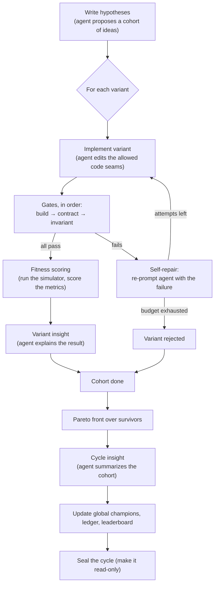

# Evolve

Evolve is a research framework that **evolves cache policies**. It runs a loop of *cycles*; in each cycle an AI agent proposes a cohort of ideas, the framework turns each idea into a real code variant, checks every variant for correctness, measures how well it performs, and keeps a permanent record of what survived and why.

This wiki is the user-facing guide. It is self-contained — you can understand the whole flow here without reading the code. When you want to go deeper, each page links to the exact source of truth in the repository.

- **New here?** Read this page top to bottom.
- **Want the vocabulary?** See [Concepts](Concepts).
- **Want to know how variants are scored?** See [Evaluation and Fitness](Evaluation-and-Fitness).
- **Setting up a measurement baseline?** See [Baseline](Baseline).
- **Choosing what to evolve?** See [Subjects](Subjects).

## The end-to-end flow

From a user's standpoint there are four steps: **install → configure → run → read the outputs.**

### 1. Install

Clone the repo and install it (see the [README](https://github.com/yanivholder2/cache-evolve/blob/main/README.md) for the exact commands). With [uv](https://github.com/astral-sh/uv) that is `uv sync`; without it, a plain virtualenv plus `pip install -e .` works too.

### 2. Configure

Every setting has a documented default in [`config.toml`](https://github.com/yanivholder2/cache-evolve/blob/main/config.toml). You change a default by editing that file, or override it for a single run by passing the matching flag. Run `evolve --help` to see the full flag list.

Two settings you will usually think about first:

- **The subject** — *what* you evolve (`--subject`, e.g. `dash`). See [Subjects](Subjects).
- **The AI-agent backend** — *who* does the proposing and implementing (`--ai-agent-tool`). This one has **no default**: if neither the flag nor `config.toml` provides it, the run stops and tells you to pick one.

Other common knobs: `--cycles` (how many cycles to run) and `--cohort-size` (how many variants per cycle).

### 3. Run

```bash
evolve --cycles 3 --cohort-size 4
```

Each cycle runs the pipeline below. Cycles run sequentially; a failing cycle aborts the run. When a cycle finishes it prints a line like:

```
cycle 0001 complete — sealed at outputs/.../cycles/0001 (cohort=4)
```

### 4. Read the outputs

Everything a run writes lands under the outputs directory (default `outputs/<timestamp>/`, gitignored). The repository itself is never modified. See [Where outputs land](#where-outputs-land) below.

## What happens inside a cycle

A cycle is a pipeline. The AI agent does the *judgment* steps (proposing, implementing, writing prose insights); everything else is deterministic.



Step by step:

1. **Hypotheses.** The agent proposes a *cohort* of distinct ideas, one per intended variant.
2. **Implement + gate (per variant).** For each idea the agent writes a code *variant*, then three correctness *gates* run in order — **build**, **contract**, **invariant**. A gate failure triggers a bounded **self-repair** loop: the agent is re-prompted with the exact failure and tries again, up to a configured attempt budget. Run out of budget and the variant is dropped (softly — other variants continue).
3. **Fitness.** Each surviving variant is scored by running it through the cache simulator and computing one or more fitness dimensions (e.g. hit rate). See [Evaluation and Fitness](Evaluation-and-Fitness).
4. **Insights.** The agent writes a short insight per surviving variant, then one insight summarizing the whole cohort.
5. **Pareto + records.** The framework computes the cohort's Pareto front, updates the global champions across all cycles, appends one row to the immutable ledger, and regenerates the leaderboard.
6. **Seal.** The cycle directory is finalized and made read-only so results can't be altered after the fact.

For precise definitions of every term, see [Concepts](Concepts).

## Where outputs land

Under the outputs directory (default `outputs/<timestamp>/`):

```
cycles/
  0001/                       one directory per cycle, sealed when complete
    hypotheses/               the cohort's proposed ideas
    variants/
      v001/
        attempts/             each implementation attempt (overlay + agent log)
        rejection.md          why an attempt was rejected, if any
        eval/                 fitness results, incl. fitness-vector.json
        insight.md            the agent's per-variant insight
    winners.json              the cohort's Pareto front
    cycle-insight.md          the agent's cohort summary
    SEALED                    marker; the cycle is now read-only
cycles-ledger.jsonl           append-only, one row per cycle
leaderboard.md                regenerated every cycle
champions.json                global Pareto champions across all cycles
cross-cycle-insights.md       the agent's narrative across cycles
logs/                         per-cycle logs (kept writable after sealing)
```

A *sealed* cycle has a `SEALED` marker and is stripped of write permissions, so a finished cycle is a permanent record.

## Going deeper

This wiki covers the user-facing flow. The repository holds the canonical detail:

- [`CONTEXT.md`](https://github.com/yanivholder2/cache-evolve/blob/main/CONTEXT.md) — the framework's vocabulary glossary.
- [`docs/`](https://github.com/yanivholder2/cache-evolve/tree/main/docs) — architecture decision records and reference docs.
- Each subject's own `CONTEXT.md` under `inputs/subjects/<name>/`.
