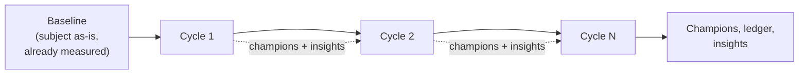
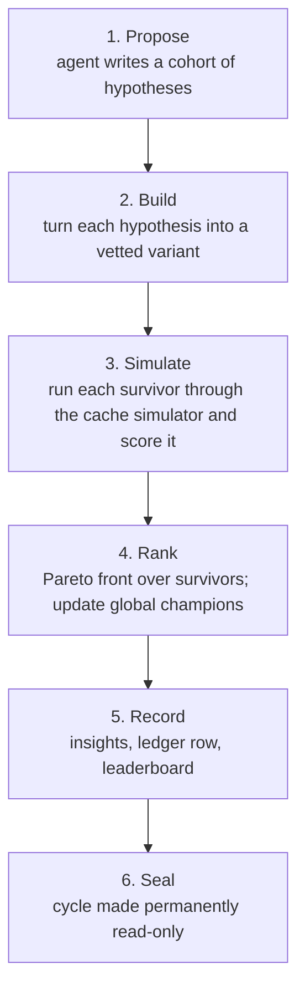
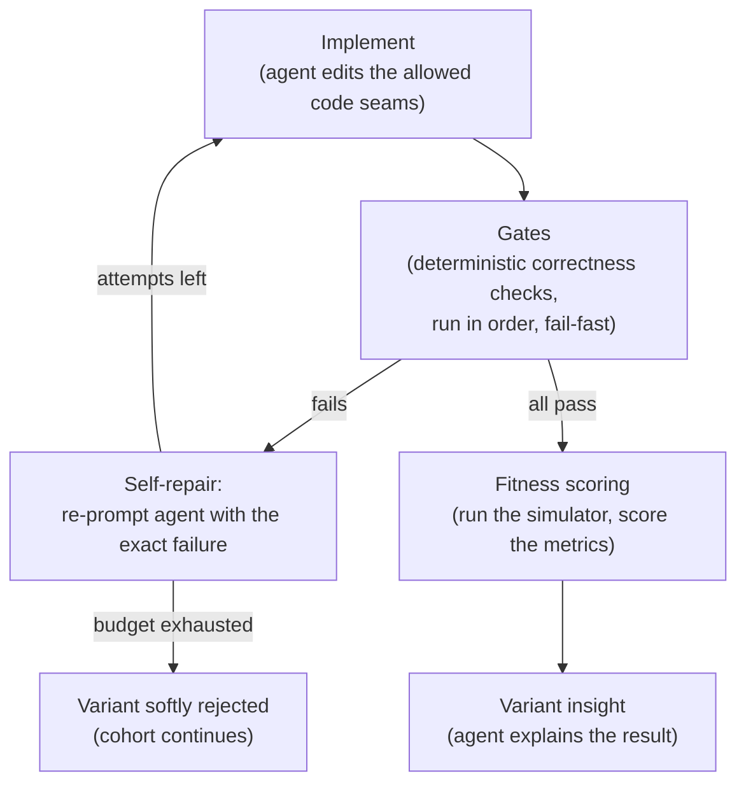

# Evolve

Evolve is a research framework that **evolves cache policies**. It is an **agentic framework**: it relies on a large language model to generate the ideas it tries and the insights it records, while the framework around the LLM turns each idea into real, compiled code, proves it is still a correct cache, measures how well it performs, and keeps the best — over and over. Instead of a human hand-tuning a cache, the agent proposes the changes and explains the results; the framework does everything deterministic in between. The result is a search that climbs toward better cache policies while leaving a permanent, auditable trail of what it tried and why.

This page explains *what the framework does and how the evolution flows*. It does not cover installing or running it — for that, see the [README](https://github.com/yanivholder2/cache-evolve/blob/main/README.md). For precise definitions of every term used here, see [Concepts](Concepts).

## The shape of a run

A run is an **evolutionary loop**. It starts from a [baseline](Baseline) — the subject cache exactly as it is checked in, with its performance already measured — and then runs a sequence of [cycles](Concepts#cycle). Each cycle produces a fresh batch of candidate caches, keeps the ones that win, and feeds those winners forward so the next cycle has something better to build on.



Two things carry across the dashed arrows and make this a *search* rather than N independent experiments:

- **Champions** — the best variants found so far. From cycle 2 onward, the agent is required to build at least one new idea on a current champion, so the search keeps *exploiting* what already works instead of starting over each time.
- **Insights** — the agent's own prose notes on what it learned, so later cycles reason with the history of earlier ones.

Cycles run strictly one after another, and a cycle that fails outright aborts the whole run.

## Inside one cycle

A cycle moves through phases. The AI agent does the *judgment* phases — proposing ideas, writing code, explaining results — and the framework does everything deterministic around them: building, checking, simulating, ranking, recording.



1. **Propose.** The agent writes a [cohort](Concepts#cohort) of [hypotheses](Concepts#hypothesis) — distinct ideas for improving the cache, one per intended candidate. On continuation cycles at least one must extend a current champion.
2. **Build.** Each hypothesis is turned into a [variant](Concepts#variant): the agent writes the code and the framework puts it through the correctness [gates](Concepts#gates). Variants that can't be made correct are dropped without sinking the cycle.
3. **Simulate.** Each surviving variant is run through the cache simulator — its native library is built and replayed against the configured traces and cache sizes — and the raw metrics are scored into a [fitness](Concepts#fitness) vector. See [Evaluation and Fitness](Evaluation-and-Fitness). (Build and simulate aren't two cohort-wide passes: each variant is built, gated, and simulated together, in parallel with the others — see [the per-variant pipeline](#the-per-variant-pipeline).)
4. **Rank.** Because performance is multi-dimensional, "best" is a [Pareto front](Concepts#pareto-front-and-champions), not a single winner. The framework computes the front over this cycle's survivors, then folds them into the global champions across all cycles so far.
5. **Record.** The agent writes a per-variant insight and a cohort summary; the framework appends one immutable row to the ledger and regenerates the leaderboard.
6. **Seal.** The cycle's directory is finalized and made read-only, so a finished cycle is a permanent record that nothing later can alter.

## The per-variant pipeline

Phase 2 is itself a small loop, run for every hypothesis in the cohort. This is where an idea either becomes a correct, measured cache or gets rejected.



- **Implement.** The agent edits only the code seams the subject exposes (its [extension points](Concepts#extension-points-and-authoring-scope)). The edit is stored as an *overlay*, so the subject's own source is never mutated.
- **Gates.** A series of deterministic [correctness gates](Concepts#gates) run in a fixed, fail-fast order, the first failure stopping the variant. The framework supplies a core set, and a subject can append its own.
- **Self-repair.** A failed gate doesn't kill the variant immediately: the agent is re-prompted with the exact failure and tries again, up to a bounded attempt budget. Exhaust the budget and the variant is *softly rejected* — dropped while the rest of the cohort carries on. (A cycle with zero survivors aborts.)
- **Fitness.** A surviving variant is run through the cache simulator and scored into a fitness vector. See [Evaluation and Fitness](Evaluation-and-Fitness).

## What a run leaves behind

The framework's defining habit is that it **never forgets and never overwrites**. Every cycle appends to a permanent record rather than mutating an earlier one, and a sealed cycle is stripped of write permission. The lasting artifacts of a run are:

```
cycles/
  0001/                       one directory per cycle, sealed when complete
    hypotheses/               the cohort's proposed ideas
    variants/
      v001/
        attempts/             each implementation attempt (overlay + agent log)
        rejection.md          why an attempt was rejected, if any
        eval/                 fitness results, incl. fitness-vector.json
        insight.md            the agent's per-variant insight
    winners.json              the cohort's Pareto front
    cycle-insight.md          the agent's cohort summary
    SEALED                    marker; the cycle is now read-only
cycles-ledger.jsonl           append-only, one row per cycle
leaderboard.md                regenerated every cycle
champions.json                global Pareto champions across all cycles
cross-cycle-insights.md       the agent's narrative across cycles
```

The append-only ledger and read-only cycles are deliberate design decisions, so a completed run is a reproducible, auditable account of the search — not just its final answer. See [ADR 0001](https://github.com/yanivholder2/cache-evolve/blob/main/docs/adr/0001-append-only-insight-ledger.md).

## Going deeper

- [Concepts](Concepts) — the full vocabulary in one place.
- [Subjects](Subjects) — what a cache subject is and how one is declared.
- [Evaluation and Fitness](Evaluation-and-Fitness) — how a surviving variant is scored, down to the Caffeine simulator.
- [Baseline](Baseline) — how a subject's grounding measurement is taken.
- [`CONTEXT.md`](https://github.com/yanivholder2/cache-evolve/blob/main/CONTEXT.md) and [`docs/`](https://github.com/yanivholder2/cache-evolve/tree/main/docs) — the canonical glossary and the architecture decision records.
